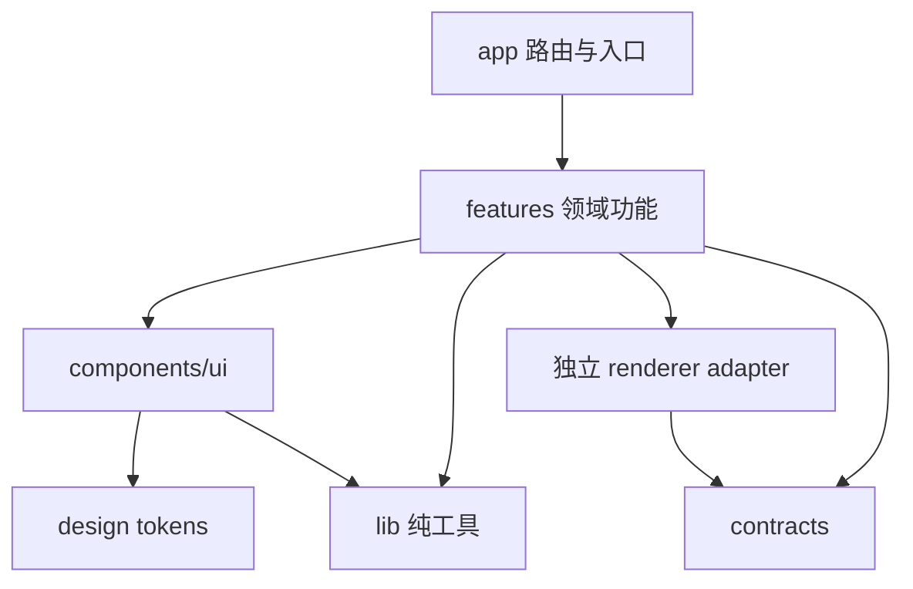

# 00｜单人产品工厂：通用前端架构、设计系统与分包规范

> 版本：2026.10 · 适用：个人开发者 + OpenCode/Codex 等代码助手 · 技术范围：**前端、Web UI、浏览器渲染、资源与构建**。
>
> 本卷是其余六卷的总入口；按需组合，不要求一次性安装所有依赖。本文是**可复用工程基线**，不是已实现的代码仓库。

## 0.1 七卷目录

| 卷 | 领域 | 典型项目 | 核心判断 |
|---|---|---|---|
| [00 通用](./00_通用_单人产品工厂与前端架构规范.md) | 单人产品工厂 | 任意新项目 | 先统一规范，再选择框架 |
| [01 商业展示](./01_网站与商业展示.md) | 网站与商业展示 | 简易/高端企业官网、SaaS 营销站、跨境电商、3D 产品配置器 | SEO 和转化优先 |
| [02 业务工具](./02_业务应用与生产工具.md) | 业务应用与生产工具 | 后台、Pagevela 风格编辑器、AI Agent 可视化、BI、海报与视频工作台 | 任务完成度与交互优先 |
| [03 数字孪生](./03_空间与数字孪生.md) | 空间与数字孪生 | 农村/农田、家庭住宅、工厂、园区、仓储、BIM | 坐标、几何真实度与帧率优先 |
| [04 教育专业](./04_教育与专业可视化.md) | 教育与专业可视化 | Voxnelo 风格语言学习、互动实验、医学/工程 3D 教学 | 教学可用性、准确性、隐私优先 |
| [05 互动娱乐](./05_互动娱乐与沉浸体验.md) | 互动娱乐与沉浸体验 | 2D/3D 网页游戏、虚拟展馆、数字文旅、互动发布会 | 稳定游戏循环与资产流水线优先 |
| [06 地理公共](./06_地理数据与公共展示.md) | 地理数据与公共展示 | 交通、地图故事、公共数据仪表盘、新闻互动报告 | 数据溯源、清晰表达、快速加载优先 |

## 0.2 总目标与红线

**目标**：让一个人能够连续交付多个视觉风格独特、架构可控、能持续迭代的产品，而不是维护大量外观相似的演示站。

**不可妥协的规则**：

1. **先做一个可真实使用的垂直切片**，再扩展菜单、主题和复杂引擎；不用空的“仪表盘示例”充当产品。
2. **每个项目有唯一业务主线和视觉符号**；设计 token、排版、动效节奏、配色、插画/3D 语言有自己的方案。
3. **不主动重写稳定旧项目**：Pagevela 现为 React + Vite 本地优先 PWA；Voxnelo 现为 Electron + React + Rsbuild，均不能因为新增 Next.js 标准就迁移。
4. **不“全家桶安装”**：同类功能优先只选一个主库。不得为一个普通页面同时引入 GSAP、Motion、Rive、Lottie 和 Three.js。
5. **Next.js 16 自带 Turbopack**；Next.js 工程无需再用 Vite 打同一个应用。独立 SPA / 浏览器游戏 / 组件实验室可以用 Vite 8 或现有构建器。
6. **前端 UI 与图形渲染分层**：React 负责页面与慢速 UI 状态；GPU/游戏引擎负责每帧场景更新；不要每帧 setState。
7. **隐私、可访问性、内容真实性优先**；仅在获得授权时使用用户数据、第三方媒体和外部 API。
8. **保留人工发布/上线审查门禁**：视觉正确、实际设备验收、协议/素材授权、内容合规都要有可检查证据。
9. 本套文档只定前端及浏览器渲染架构；后端、数据库、云部署、营销平台自动化均通过边界接口描述，不代替其独立规范。

## 0.3 项目选择器：先选产品形态，再选框架

| 产品特征 | 主框架与构建 | 客户端渲染 | 补充能力 |
|---|---|---|---|
| 企业信息官网、博客、内容 SEO | **Astro + TypeScript** | CSS、少量 React Islands | Tailwind、Lucide、基础 Motion/GSAP 按需 |
| 高端品牌官网、视频 / 3D 叙事 | **Next.js 16 + React** | Motion、GSAP、R3F / HTML5 Video | `dynamic()` 客户端延迟加载 |
| SaaS 官网 + 工作区 + SEO | **Next.js 16** | shadcn/ui、TanStack Query | 按路由拆分营销和工作区 |
| 已上线 React 本地优先 PWA | **保留当前 Vite / 现有工具** | 原有 UI / IndexedDB | 只优化分包，不重平台化 |
| 专业桌面应用 | **保留现有 Rsbuild/Electron 等** | React + Web Audio / Canvas | 渲染器与桌面桥适配 |
| GIS / 大规模地理数字孪生 | React 载体（Next 或 Vite） | **CesiumJS** | 3D Tiles、空间叠加与数据联动 |
| 住宅室内 / 工厂精细模型 | React 载体 | **Three.js + R3F v9 + Drei** | GLB、LOD、剖切、拾取 |
| 纯浏览器原生 3D 游戏 | **TypeScript + Vite** 或引擎模板 | **Babylon.js / PlayCanvas** | React 仅负责外围 UI |
| 2D 游戏 / 复杂精灵 | TypeScript + Vite | **Phaser / PixiJS** | Canvas / WebGL |
| 地图叙事 / GIS 大数据 | Astro/Next/React | **MapLibre + deck.gl** | ECharts / D3 |

**迁移约束**：当一个既有工程有良好体验和持续 CI 时，换构建器的收益必须有可度量指标；“看起来更流行”不算收益。

## 0.4 默认技术池与职责表

| 类别 | 默认 / 备选 | 解决什么问题 | 什么时候不要用 |
|---|---|---|---|
| 语言与 UI | TypeScript 严格模式、React 19 | 类型安全与交互组件 | 纯 Astro 静态页不强制完整 React 运行时 |
| 页面应用框架 | Next.js 16 / Astro / Vite | 应用路由、静态内容、独立 SPA | 同一包中并列使用两套构建链 |
| 样式 | Tailwind CSS 4、CSS Variables | 统一设计语言、响应式 | 无需引入重型 CSS-in-JS 作为默认 |
| UI 基座 | shadcn/ui + Base UI | 可定制、无障碍组件 | 极小 landing page 按需引入即可 |
| 图标 | Lucide React | 一致线性图标、按需导入 | 品牌 Logo、游戏技能图标要用正式资产 |
| 动效 | CSS → Motion → GSAP | 小交互 → React 布局动画 → 复杂时间轴 | 普通 hover 别上 GSAP |
| 状态 | 本地状态 / Zustand | 局部状态与共享 UI 状态 | 服务器请求缓存不交给 Zustand |
| 异步数据 | TanStack Query | 缓存、失效、刷新、异步状态 | 静态内容页并非必装 |
| 表格 | TanStack Table + Virtual | 无样式表格逻辑、长列表 | Excel 级复杂表格评估 AG Grid |
| 表单 | React Hook Form + Zod | 动态字段和运行时校验 | 仅一个简单输入时不必全部安装 |
| 图表 | ECharts / Recharts / D3 | 工业复杂图 / SaaS 小图 / 深度自定义 | 选主库，勿多库重复加载 |
| 工作流 | React Flow | 节点编辑、连线、缩放 | 普通流程展示用 SVG 即可 |
| Canvas 编辑 | Konva / Fabric | 设计器、图层、选择和导出 | 静态海报可以直接 HTML/CSS |
| 3D 局部 | Three.js + R3F + Drei | 定制三维视图和模型交互 | GIS 地理全景首选 Cesium |
| 地理 3D | CesiumJS | WGS84、3D Tiles、地形和影像 | 家具/室内微场景不必使用 |
| 游戏 | Babylon.js / PlayCanvas | 3D 引擎、动画、粒子和渲染循环 | 做资讯页面不需要游戏引擎 |
| 2D 大量对象 | PixiJS / Phaser | 高效 2D 绘制或游戏逻辑 | 普通图标和图表不要用它们 |
| 地图 | MapLibre、deck.gl、OpenLayers | 矢量地图、大量 GPU 图层、专业 GIS | 只展示一张静态定位图不必全装 |
| 底层图形 | WebGL2；WebGPU 按需 | 稳定渲染；高级 GPU 计算 | 不提供回退就直接面向全量移动端 |

## 0.5 分包不是一件事：四种“包”要分清

| 类型 | 意思 | 默认策略 | 验收 |
|---|---|---|---|
| **源码包（package）** | 可复用的 npm / workspace 模块 | 真正跨至少两个应用时才抽取 | 公开入口清晰、无环境泄漏 |
| **业务模块（feature）** | 一个业务能力目录 | 按使用者目标切分，不按所有组件类型分层 | 目录职责单一、可删除不连锁爆炸 |
| **产物 Chunk** | 浏览器加载的 JS/CSS 文件 | 路由级 + 重型能力级懒加载 | 首屏没有编辑器/地图/游戏 runtime |
| **资产包（asset pack）** | 图片/视频/GLB/地图瓦片等 | 预览图优先，模型分级按需加载 | 低速网络可用、失败可重试 |

### 0.5.1 单个项目首选结构

```text
my-product/
  AGENTS.md                   # 代码助手不可越界规则
  README.md                   # 一句话定位、真实功能、验收方式
  package.json
  pnpm-lock.yaml
  src/
    app/                      # 仅放框架入口/路由/布局
    features/
      onboarding/
      workspace/
      export/
    components/
      ui/                     # 基础组件
      shared/                 # 项目内复用组件
    design/
      tokens.css              # 主题/颜色/排版/动画变量
    lib/                      # 与领域无关的纯函数和适配器
    contracts/                # 浏览器侧 schema 与类型
  public/
    images/
    video/
    models/                   # 大型资源建议外置按需获取
  tests/
    unit/
    e2e/
    a11y/
  docs/
    decisions/                # ADR：权衡、取舍和风险
    acceptance/               # 截图/指标/人工验收记录
```

Next.js 项目可把 `src/app/` 作为框架路由；Astro 使用 `src/pages/`；游戏将 `src/app/` 换为 `src/game/`。结构是**逻辑示例**，以当前版本框架约定为准。

### 0.5.2 什么时候才做 Monorepo？

- **一个产品**：单仓库、单 `package.json` 是默认起点。
- **两个产品真正共享稳定类型和组件**：可使用 `pnpm workspaces`，抽出 `packages/tokens`、`packages/ui`、`packages/contracts`、`packages/utils`。
- **三个以上产品，至少两个真实消费方并可独立测试**：再考虑 packages 版本规范和变更记录。
- 不应抽共享 `business`, `app-shell` 巨包；项目外观/信息架构/品牌动效继续独立。工作区包也应有专属公开入口和 `exports`。

```text
portfolio-workspace/                 # 可选，不要求现有仓库搬迁
  apps/
    portal-a/
    portal-b/
  packages/
    tokens/                         # 纯 CSS variables / JSON tokens
    ui/                             # 小而稳定的 UI 基础组件
    schemas/                        # TypeScript + Zod，无浏览器副作用
    testing/                        # 共享测试工具
  pnpm-workspace.yaml
```

**抽包前须回答**：第二个真实使用者是谁？可以独立测吗？如果改一个产品时必须连带发布五个包，说明边界过度抽象。

### 0.5.3 依赖方向（必须单向）



**禁止**：`lib` 反向 import `features`；`features/A` 直接读取 `features/B` 的内部文件；`components/ui` 读取业务数据；普通首页静态 import WebGL 游戏引擎。

## 0.6 前端性能预算与分包策略

这些数字是**新产品起始验收目标，不是行业统一阈值或自动达标保证**。以真实设备和模拟慢网测量，建立基线后再按受众优化。

| 场景 | 首页 / 首次可交互原则 | 建议初始预算和测量 |
|---|---|---|
| 简单企业官网 | 页面正文静态可见，导航和询盘可用 | 尽量保持首屏自有 JS ≤100 KB gzip（实验目标） |
| SaaS 营销首页 | SSR/静态 HTML，主 CTA 无需加载工作区 | 首屏不下载 Monaco、PDF、3D、富文本编辑器 |
| 后台管理 | 加载当前路由所需组件 | 首屏不下载全部表格/图表/工作流包 |
| 3D 展示 | 先 poster，再分阶段载入几何/纹理 | 记录模型、纹理、Draw Calls、峰值内存 |
| 游戏 | 先菜单及进度，再载入首关资产 | 大资源分页/分关卡下载，失败可重试 |
| 地图故事 | 文字/图片先到达 | 地图可交互时才初始化主地图 Runtime |

- Web 体验默认关注 **LCP、INP、CLS**；建议目标分别为 **≤2.5 s、≤200 ms、≤0.1**（真实用户 p75 的良好体验阈值，非单次 Lighthouse 分数）。
- 3D 初始质量建议目标：桌面稳定 **60 FPS**、典型移动设备稳定 **30 FPS**；具体按目标机型、场景规模实测调整。
- 进阶剖析：FCP/TTFB、long tasks、memory、GPU time、3D Tiles / GLB 下载耗时与缓存命中。
- 推荐切割方式：`route lazy` → `heavy editor lazy` → `visualization canvas lazy` → `model/texture/tiles async`；不要只看 Chunk 数量。

**React/Next.js 例：仅客户端按需加载重型可视化**（Next.js App Router 中此文件为 Client Component）：

```tsx
'use client';
import dynamic from 'next/dynamic';

const Scene = dynamic(() => import('./SceneClient'), {
  ssr: false,
  loading: () => <div role="status">正在加载三维场景…</div>,
});

export function SceneGate({ enabled }: { enabled: boolean }) {
  return enabled ? <Scene /> : <button>打开三维视图</button>;
}
```

上例仅展示**加载边界**；实际按钮事件由调用方管理 `enabled` 状态。`SceneClient` 必须在浏览器端操作 WebGL/Canvas，不要在服务端组件执行浏览器 API。

## 0.7 产品差异化：相同底层，不同“外观与体验签名”

每个项目建立一张设计卡片，**不允许直接复用另一产品的主题色、Hero 排版、插画和动效组合**：

```yaml
product_identity:
  promise: "用户在 10 秒内理解的价值"
  primary_user: "最核心的一类人"
  visual_signature: "例如：自然绿+地图坐标 / 深色金属+机械剖切"
  typography: "标题/正文层级与中英文字体策略"
  motion_language: "稳健、克制 / 动态、探索 / 游戏化"
  icon_family: "lucide；必要时专用领域图标"
  empty_state: "真实且可操作的空状态"
  first_success: "第一次成功操作是什么"
  non_goals: ["暂不开发的功能1", "暂不开发的功能2"]
```

差异化从任务体验来：Pagevela 的即时纸张预览、Voxnelo 的听说练习、农田数字孪生的地理定位、住宅的尺寸真实度、游戏的战斗反馈。炫酷动画不能替代真实业务价值。

## 0.8 质量门禁：一个人也能稳定交付

| 门禁 | 最低验收证据 |
|---|---|
| G0 产品说明 | 单一目标用户、一个任务闭环、明确非目标 |
| G1 架构 | 模块边界、目录树、ADR-001、打包与依赖选择 |
| G2 可视化 | 设计 Token、三种响应式宽度、所有交互有状态 |
| G3 正确性 | Typecheck、Lint、关键纯逻辑单测、真实浏览器 E2E |
| G4 可访问性 | 键盘路径、焦点、对比度、`prefers-reduced-motion`、替代内容 |
| G5 性能 | Bundle/资源清单、真实网络/设备截图、指标记录 |
| G6 发布 | 无未授权资产/令牌泄露；回退方案和变更记录 |
| G7 迭代 | 真实反馈→归类→取舍→更新产品设计卡 |

### 0.8.1 标准完成定义（DoD）

- [ ] 第一目标用户可以独立完成一条关键路径。
- [ ] Loading、Empty、Error、Success 四态齐全；失败有下一步。
- [ ] 所有外部内容和资产标注来源、使用许可与限制。
- [ ] 不同设备上完成视觉/交互验收；3D 场景有 WebGL 不可用降级。
- [ ] 页面没有因为动画造成重要操作受阻；支持减少动态效果。
- [ ] 独立演示可重现，无虚假成功提示或伪造数据宣称。
- [ ] CI 至少覆盖类型、Lint、关键测试、生产构建。
- [ ] 没有为了模板一致性重构其它稳定项目。

## 0.9 一个人 + OpenCode 的实施规范

**每轮只允许一个“核心垂直切片”交付**。示例节奏不是时间承诺：

1. **发现**：读取仓库，盘点依赖、可复用文件、已有约束、版本、CI、资源版权。先提出变更范围。
2. **设计**：写 ADR、文件清单、验收用例、分包预算；明确是否创建新产品，而非改造旧产品。
3. **实现**：UI 骨架 + 真实数据或可标识的测试数据 + 一个完整交互闭环。
4. **自测**：浏览器视觉截图 + Typecheck/Lint/Test/Build + 性能数据。
5. **审查**：生成变更摘要、风险清单、截图、可复测步骤，等人工决定合并发布。
6. **提炼**：只把成熟且跨项目重复的能力抽为通用包，不抽风格模板。

### 推荐放进每个仓库的 `AGENTS.md` 约束

```md
# 前端项目代码助手约束
- 先读 README、现有 package.json、lockfile、路由约定及本产品设计卡。
- 遵循现有构建器：禁止仅为了统一技术栈从 Vite/Rsbuild 迁移 Next.js。
- 只能修改本任务批准的文件；禁止删除用户数据、原有资产或重建目录。
- 不引入重复的大型 UI、状态、图表、渲染库；先说明理由、预算和许可证。
- 业务代码按 features 组织；禁止跨模块导入内部文件。
- 所有 WebGL/WebGPU/音视频和浏览器 API 必须有能力检测、资源释放与降级。
- 每次完成运行 typecheck、lint、tests、build；记录实际运行结果，不伪称测试通过。
- 对外发布前报告变更、截图、性能预算和未解决问题，等待人工批准。
```

### 新项目立项问答模板

```yaml
product:
  type: "官网|SaaS|工具|数字孪生|教育|游戏|地图故事"
  first_user: ""
  first_job_to_be_done: ""
  platform: "桌面|移动|二者"
  must_have: []
  non_goals: []
frontend:
  framework: "Astro|Next.js|Vite|已有框架"
  renderer: "none|Canvas|Three/R3F|Cesium|MapLibre|Babylon|PlayCanvas"
  motion: "CSS|Motion|GSAP|engine-native"
  primary_icon: "Lucide|Phosphor|custom SVG"
  offline: false
  seo: true
  a11y_target: "WCAG 2.2 AA"
  browser_fallback: "静态海报/视频/文字列表"
quality:
  first_success_test: ""
  routes_to_split: []
  heavy_assets_to_lazy_load: []
  key_e2e: []
  performance_budget: "初始测量后固化"
```

## 0.10 全卷共用的 ADR 模板

```md
# ADR-001: 选择 [某技术] 用于 [场景]
日期：YYYY-MM-DD
状态：拟议 / 已接受 / 已弃用

## 需求与约束
- 首要用户：
- 关键交互：
- 目标浏览器/硬件：
- 既有代码/资产：

## 候选
| 方案 | 优点 | 代价 | 风险 |
|---|---|---|---|

## 决定与边界
选择：
明确不采用：
仅在这些模块安装：
退出/迁移条件：

## 验收
- [ ] 功能验收
- [ ] 性能验收
- [ ] 可访问性验收
- [ ] 许可证与资产来源验收
```

## 0.11 协议、许可证与版本约束

- 外部图片、模型、纹理、字体、音频、地图瓦片、商品素材、医学数据、用户语音必须分别确认许可证/授权，不应视为“网上可见就可商用”。
- Open-source **运行库**与付费 SaaS / 企业特性区分，例如专业网格、图表、地图影像、编辑器云协作可能有不同许可。
- 依赖版本以项目 `lockfile` 为准；升级需做兼容矩阵和浏览器 E2E。3D 引擎版本、React 主版本和 R3F 主版本须相容。
- 2026-10：Next.js 默认 Turbopack；R3F **v9 对 React 19**，v10 仍标为 Alpha；Shopify Hydrogen 2026-10 已可搭配 Next.js 或 React Router。老教程不能作为当前安装唯一依据。

## 0.12 参考资料（官方优先）

- Next.js App Router: https://nextjs.org/docs/app
- Next.js Turbopack: https://nextjs.org/docs/app/api-reference/turbopack
- Astro Islands: https://docs.astro.build/en/concepts/islands/
- Shopify Hydrogen 2026-10: https://shopify.dev/changelog/blog/hydrogen-2026-10-is-now-available
- Motion React: https://motion.dev/docs/react
- React Three Fiber: https://r3f.docs.pmnd.rs/getting-started/introduction
- Three.js: https://threejs.org/docs/
- CesiumJS: https://cesium.com/learn/cesiumjs-learn/
- PlayCanvas: https://developer.playcanvas.com/user-manual/engine/
- Web Vitals: https://web.dev/articles/vitals

---

**单人产品工厂的真正成果不是 7 套相同的模板皮肤，而是 7 套清晰的技术决策和可靠的产品验收方法。**