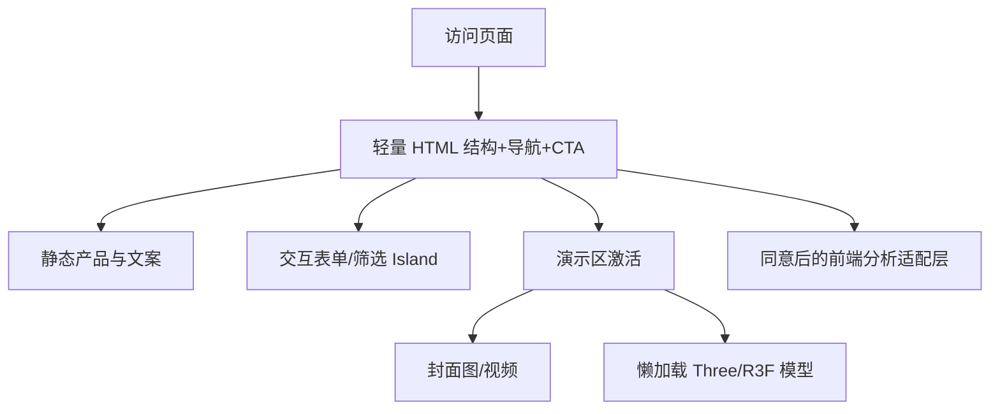

# 01｜网站与商业展示：从简单企业官网到高端 3D 品牌站、SaaS 和跨境独立站

> 领域定位：让访客**看懂、相信、愿意行动**；SEO、品牌视觉、首屏性能、可访问性和转化链路优先。遵循 [00 通用规范](./00_通用_单人产品工厂与前端架构规范.md)。只涉及前端与浏览器渲染。

## 1. 场景与技术决策矩阵

| 场景 | 核心体验/能力 | 主技术栈 | 不应该默认加的东西 |
|---|---|---|---|
| **简单企业门面官网** | 公司介绍、服务、案例、地图入口、联系询盘、双语 | **Astro + TS + Tailwind + Lucide** | Next.js 运行态、WebGL、重型状态库 |
| **时髦高端动态企业官网** | 品牌电影化 Hero、滚动叙事、视频与 3D 产品展示、精品互动 | **Next.js 16 + React + Motion + GSAP + Three.js/R3F** | 全站常驻 3D 场景、所有栏目都做视差 |
| **SaaS 营销站** | 价值定位、功能演示、定价、FAQ、真实 demo、转换 CTA | **Next.js 16** 或内容型 Astro | 将完整 SaaS 编辑器塞入营销首页 |
| **跨境 DTC 零售独立站** | 商品、变体、收藏、购物车 UI、移动端、3D/视频展示 | **Shopify Theme**；定制时 **Next.js + Hydrogen 2026-10** | 未验证需求就 Headless 重造所有电商 UI |
| **跨境 B2B 询盘网站** | 产品目录、规格、下载、行业解决方案、表单 | **Astro**，复杂目录再 Next.js | 假购物车、和 B2B 转化无关的订阅功能 |
| **3D 商品配置器** | 材质/配色/组件切换、360°、产品拆解、效果预览 | **Next.js + R3F + Drei + GSAP（按需）** | 将模型/贴图全部放进首屏 Bundle |
| **AR 商品试摆** | 手机 3D 查看、AR 放置、尺寸示意、静态兜底 | `<model-viewer>` / Three.js + WebXR | 假设所有 iOS/Android 都支持同一 AR 路径 |
| **互动案例 / 品牌故事** | 滚动叙事、图文混排、信息图、视频时间线 | Astro/Next + GSAP + SVG/D3 | 每页都上游戏引擎 |

**只选一个“主卖点”**：例如设备厂展示真实可交互的 3D 设备；农产品品牌强调溯源地图和种植过程；软件产品强调 30 秒完成一项任务，而不是所有品牌都采用深色霓虹炫光。

## 2. 两种企业官网必须分开做

### 2.1 标准型企业官网（交付快、长期易维护）

**导航结构**：首页、关于我们、服务/产品、案例、新闻/知识、联系我们、隐私和法律信息。

**功能**：产品卡片与分组；可信资质和案例（需可验证）；电话/邮件/表单跳转；语言切换；元数据/站点地图；OG 分享图；移动优先；图片尺寸预留。

**推荐**：Astro + TypeScript + Tailwind；必要的联系交互/筛选作为局部 React Islands；小按钮用 CSS 动画。内容可用 Markdown/MDX 或可替换的内容接口。

**设计特征**：精确排版、优秀图片、清晰字体层级、留白与真实案例，比复杂粒子更能建立信任。

### 2.2 高端动态企业官网（品牌形象型）

**导航结构**：沉浸 Hero、品牌主张、技术/产品亮点、核心产品 3D、应用案例、技术指标、视频故事、团队/合作伙伴、最终询盘 CTA。

**交互编排**：

1. 静态/短视频 poster 立即出现；明确文字与 CTA **不等待 WebGL**。
2. 用户进入展示段后，懒加载 3D 模型，支持拖拽旋转、点选热点及配置。
3. 用 Motion 驱动按钮、弹窗、布局切换；用 GSAP ScrollTrigger 驱动段落进度和镜头/章节联动。
4. 视频使用 `<video>`、poster、`preload="metadata"`、静音自动播放按浏览器政策降级；禁止播放失败导致空白 Hero。
5. 对 `prefers-reduced-motion` 提供不移动/弱动效版本；对 WebGL 不可用提供海报或视频。
6. 移动端根据性能指标关闭昂贵阴影/高分辨率贴图，不是简单缩小桌面画面。

**视觉品质来自**品牌素材、排版、构图、材质和镜头叙事的统一；Three.js 不是“自动变高级”的开关。

## 3. SaaS 营销站：Pagevela 与 Voxnelo 的实际差异

### 3.1 Pagevela（真实仓库对照）

仓库：https://github.com/kunlong-luo/pagevela

- 2026-10 核查：**React 19 + Vite 8 + Tailwind 4 + Motion + Lucide + Zustand**；本地优先、PWA、编辑器与预览、PDF 导出。
- 现有入口包括 `LandingHero`、`LandingShowcase`、`LandingFeatures`、`LandingTemplates`、`LandingFaq`，编辑器已 `React.lazy` 分包。
- **直接可复用的营销优势**：编辑前后效果、A4/US Letter 预览、ATS 检查说明、无需账户、隐私/本地处理、可验证导出能力。
- **禁止的改造方式**：为了营销官网而直接迁移现有 PWA 到 Next.js；破坏 IndexedDB 数据、共享链接/存档兼容性；在文案中承诺未经验证的 ATS 通过率。
- 更合理选择：继续原仓库优化轻量 landing；需要大型内容 SEO 再创建**独立 Astro 营销前台**，链接现有应用，品牌资产可共享但运行构建可独立。

### 3.2 Voxnelo（真实仓库对照）

仓库：https://github.com/kunlong-luo/voxnelo

- 2026-10 核查：**Electron + React + Rsbuild + Tailwind + Base UI + Lucide**，面向本地英语听说练习；桌面端可播放、录音回听及局部离线识别配置。
- 品牌官网适合 Astro：产品体验演示、支持平台、下载校验说明、离线隐私边界、真实设备/识别能力说明。
- 交互 Demo 只能展示**确有实现的能力**；Web 端语音识别可能与桌面端隐私/离线策略不同，须单独披露。
- **切勿**将网页演示等同于全部桌面能力，或宣传所有系统上均已支持离线语音模型。

## 4. 跨境独立站细分方案

### 4.1 Shopify Theme：最小维护成本

**适合**：常规实物销售、SKU 不复杂、希望利用成熟电商结账和主题生态。前端重点是 Liquid 模板、主题区块、CSS/JS、响应式、商品图片、视频、可选 3D 商品媒体。对个人开发者，先定制高质量主题往往更划算。

### 4.2 Next.js + Hydrogen 2026-10：品牌差异化

**适合**：多语言/多市场、复杂内容与商品关联、沉浸商品页、自定义产品配置器。2026-10 新 Hydrogen 是可与多种 JS 框架集成的 SDK，官方有 Next.js 和 React Router 起步模板；不要套用旧版“只支持 React Router”的教材。

**前端模块**：目录/搜索、商品详情、媒体画廊、变体选择、购物车表现层、货币/语言展示、客户界面、同意偏好、站点资讯；业务授权与结算逻辑不得通过客户端自行伪造。

### 4.3 B2B 出口企业站

强调“规格—应用—标准—案例—询盘”。产品页必须包含真实参数、尺寸单位、可下载资料、MOQ/交付说明（如适用）、多语言/多地区展示；只有明确需要在线交易时才增加购物车。

### 4.4 商品 3D / 视频素材策略

- 先放高品质封面图、展示短视频；GLB/贴图在用户交互后下载。
- 提供图片/视频替代路径、尺寸/材质说明、触屏拖动指示和键盘可操作控件。
- 纹理按设备选择分辨率，采用 glTF/GLB、KTX2、LOD、按需解码。
- 价格、库存、评价及折扣必须来自被授权的数据源；绝不编造销量或用户评价。
- 带宽受限时优先展示可信静态材质照，不以高帧率为唯一体验指标。

## 5. 站点级前端架构与分包



推荐新建 Next.js 品牌型工程：

```text
src/
  app/
    (marketing)/page.tsx
    (marketing)/products/[slug]/page.tsx
    (marketing)/case-studies/[slug]/page.tsx
    (marketing)/contact/page.tsx
  features/
    hero/
    case-studies/
    inquiry-form/
    product-configurator/
      ProductPoster.tsx
      ProductSceneClient.tsx       # 浏览器专用，dynamic SSR:false
      material-presets.ts
  components/ui/
  design/tokens.css
  content/                        # 已审核多语言文案
public/
  posters/
  video/
  models/
```

Astro 简单站使用 `src/pages/*.astro` 与 `src/components/`；只有需要 React 的交互组件才使用对应 Island。

**分包规则**：

| 层 | 应该首次加载 | 应该懒加载 | 拒绝 |
|---|---|---|---|
| Landing | 文案、标题、导航、CTA、关键图片 | 视频播放控件、复杂 carousel | 首页引入整个编辑器 |
| 3D 展示 | Poster、操作提示 | Three/R3F、GLB、纹理、后处理 | 在入口静态 import 重型引擎 |
| 电商 | 当前商品/媒体首图、商品基本交互 | 推荐区、AR、360°、高级筛选 | 结账 UI 被 3D 库阻塞 |
| 企业内容 | 标题、正文、案例摘要 | 富交互地图、动画图表 | 所有路由强制 Hydration |

## 6. 设计质量：商业网站独有标准

- **首屏回答三问**：提供什么？为谁服务？下一步点击哪里？
- **移动端 CTA**：触控面积充足，不被悬浮视频或 Cookie 控件盖住。
- **真实素材**：有来源的客户案例、可证明的产品参数、真实产品演示；AI 美图不得冒充实拍证明。
- **i18n / SEO**：规范 URL、`hreflang`（适用时）、JSON-LD（符合实际页面与规范）、sitemap、OG、清晰 title/meta。
- **无障碍**：对比度、键盘焦点、语义结构、减少动态、视频字幕/文字替代。
- **转化不是滥用打扰**：不使用无法关闭的全屏弹层或误导按钮。

### 6.1 验收阈值建议

| 核查项 | 标准 |
|---|---|
| 商业首页 | LCP p75 ≤2.5s、INP ≤200ms、CLS ≤0.1 为良好体验目标 |
| 3D 可选内容 | WebGL 不支持时仍能访问产品说明、CTA 和联系方式 |
| Hero 视频 | 网络差、自动播放被禁止时有 Poster 和可点击播放入口 |
| 商品详情 | SKU 变更能同步文字与媒体、触控操作正确 |
| 询盘 | 错误说明明确、字段校验、无虚假“发送成功” |
| 多语言 | 真实翻译与单位/币种一致性，经人工审查 |

## 7. 三类特色产品模板

### 模板 A：简洁型出口企业官网

**首页段落**：定位 → 产品分类 → 制造能力/标准（可核实）→ 应用场景 → 真实案例 → 联系 CTA。**MVP 验收**：搜索引擎可读的正文、双语路由、产品资料下载、移动端询盘。

### 模板 B：3D 工业设备高端品牌官网

**首页段落**：技术主张 → 产品海报 → 点击加载 3D → 热点讲解 → 技术指标 → 用户案例 → 视频 → 询盘。**MVP 验收**：一台授权 GLB 模型、3 个准确热点、移动端静态回退、无障碍控制、可测 FPS。

### 模板 C：SaaS 营销 + 独立应用

**首页段落**：用户痛点 → 15–30 秒真实产品视频 → 功能证明 → 对比/FAQ → 进入应用。应用在既有仓库运行。**MVP 验收**：访客可从产品页进入真实功能并完成首次操作，不能用虚构交互录屏充数。

## 8. 单人实施路径

- **S0**：确定简洁站 / 高端品牌站 / SaaS / DTC / B2B 之一，先写用户任务与非目标。
- **S1**：形成独立品牌设计卡，准备真实文字、媒体与授权清单。
- **S2**：交付 SEO 可见的完整静态内容与一个 CTA 闭环。
- **S3**：按需接入 Motion/GSAP/视频/3D，监控前后性能差异。
- **S4**：补全语言、触控、无障碍、低配置回退和产品证据。
- **S5**：仅在有真实复用时抽出 `tokens`, `video-player`, `3d-viewer` 小包。

## 9. OpenCode 可直接执行的领域任务卡

```text
阅读 00 通用规范与 01 商业展示模板、当前仓库 README/package.json/lockfile。
先确认站型：标准企业官网 / 高端动态品牌站 / SaaS 营销页 / DTC / B2B。
输出：页面信息架构、品牌设计卡、技术 ADR、关键用户路径、媒体来源清单、产物分包预算。
只实现第一条完整真实转换路径，营销 HTML 与 CTA 在 WebGL 失败时仍可用。
页面动效以 CSS/Motion 为主，复杂章节才用 GSAP；重 3D 必须惰性加载。
如项目已是 Vite/Rsbuild，禁止为了统一迁移 Next.js。
运行类型检查、Lint、关键 E2E、构建和移动端视觉验收；提供截图及实际指标。
不发布假评价、不使用未授权产品图/音乐、未经批准不自行上线。
```

## 10. 参考资料

- [00 通用工程规范](./00_通用_单人产品工厂与前端架构规范.md)
- Astro Islands：https://docs.astro.build/en/concepts/islands/
- Next.js：https://nextjs.org/docs/app
- Motion：https://motion.dev/docs/react
- Shopify Hydrogen：https://shopify.dev/docs/api/hydrogen/latest
- Shopify 2026-10 更新：https://shopify.dev/changelog/blog/hydrogen-2026-10-is-now-available
- Three.js：https://threejs.org/docs/
- Pagevela：https://github.com/kunlong-luo/pagevela
- Voxnelo：https://github.com/kunlong-luo/voxnelo