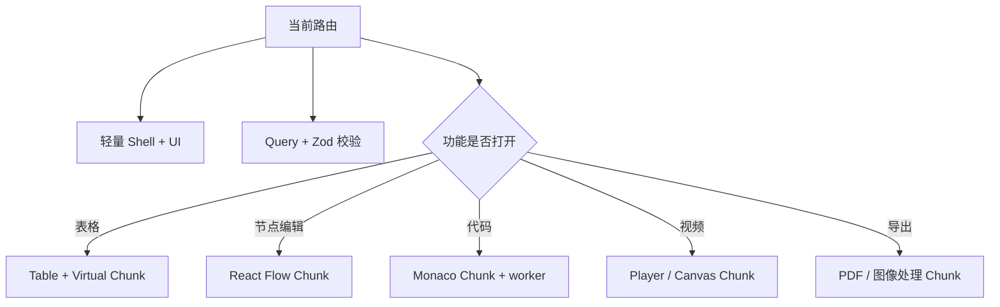

# 02｜业务应用与生产工具：高质量后台、SaaS 工作区与专业在线编辑器

> 领域定位：用户需要**高效、准确、可恢复地完成一项复杂任务**。视觉品质重要，但不能以丧失信息密度、键盘效率或数据可靠性为代价。遵循 [00 通用规范](./00_通用_单人产品工厂与前端架构规范.md)。

## 1. 场景与技术能力矩阵

| 场景 | 用户真正要完成的任务 | 前端选型 | 特色组件 |
|---|---|---|---|
| **高质量后台管理** | 查询、过滤、处理对象、复核操作 | Next.js 16 + React + shadcn/ui + TanStack | Table、Virtual、Query、ECharts |
| **AI Agent 可视化工作台** | 编排节点、运行、定位失败 | Next.js + React Flow + Monaco | 拖拽 DAG、节点 Inspector、执行轨迹 |
| **BI / 数据分析平台** | 选择指标、探索趋势、生成报告 | React + ECharts + D3/visx | 多图联动、钻取、筛选、仪表盘画布 |
| **专业在线编辑器** | 创作、预览、导出，保证不丢稿 | Vite/现有框架 + React + Zustand | 模型/视图分离、历史记录、导出工作流 |
| **在线海报与图像设计** | 编辑图层、画布、文本和商品模板 | React + Konva 或 Fabric | 选中框、吸附线、缩放、撤销重做 |
| **AI 视频 / 漫剧工作台** | 分镜、素材、字幕、时间轴、预览 | React + Remotion Player + Canvas | 时间尺、轨道、素材管理、预览 |
| **复杂表单 / 配置台** | 多阶段编辑、验证、保存草稿 | Next.js + RHF + Zod + XState（按需） | 表单进度、校验、冲突提示 |
| **开发者工具 / 在线 IDE** | 代码编辑、预览、查看结果 | React + Monaco + Panel split | 编辑器、资源树、差异视图 |
| **本地优先 PWA** | 离线创建和继续工作 | 现有 React + Vite/PWA | 离线状态、客户端存档、导出备份 |

## 2. 高质量后台：界面能力的完整分层

### 2.1 核心体验

- **App Shell**：全局搜索、侧栏、面包屑、工作区、功能反馈、全局快捷键。
- **信息层级**：总览页面回答“现状如何”，列表回答“哪些对象需要操作”，详情回答“为什么、如何处理”。
- **数据密度**：允许密集表格与自定义列、可保存筛选、可复制识别码、批量操作、导出预览。
- **四态**：空列表说明下一步；加载用 Skeleton；错误展示重试；成功展示可撤销/可追踪反馈。
- **移动/触控**：将高频查看功能适配移动端，但不假装小屏适合 Excel 级复杂编辑。
- **权限视图**：客户端可以隐藏不允许的动作，但最终授权必须由实际服务边界验证；前端隐藏不等于安全。

### 2.2 核心技术角色

| 能力 | 技术 | 设计限制 |
|---|---|---|
| 路由 | Next App Router / Vite 用 TanStack Router | 不同时创建两套路由状态 |
| UI 元件 | shadcn/ui + Base UI | 在可访问基础上自己做品牌主题 |
| 查询数据 | TanStack Query | 响应的数据校验、缓存键一致 |
| 共享 UI 状态 | Zustand | 只存当前选项/打开面板等，不复制 Query 缓存 |
| 表格 | TanStack Table + Virtual | 行模型与数据获取解耦；海量筛选走接口契约 |
| 高级网格 | AG Grid Community | 特性授权单独核对，勿依赖付费企业特性 |
| 表单 | React Hook Form + Zod | 状态切换和错误需可访问 |
| 图表 | ECharts | 图表也提供表格/文字摘要替代 |
| 动效 | Motion | 只增强反馈，不延迟完成任务 |
| 图标 | Lucide | 另配行业 SVG，避免无语义的纯图标导航 |

## 3. 三种复杂编辑器的专题模板

### 3.1 Pagevela 风格：本地优先文档编辑器

真实参考：https://github.com/kunlong-luo/pagevela

当前仓库采用 React/Vite、本地优先草稿管理、Markdown/表单双编辑与纸张预览。新项目可以学习它的**编辑—预览—导出**闭环，但不能直接复制业务外观。

**必须具备**：

1. 文档实体模型与 UI 编辑器分离；Markdown / 表单互转定义冲突策略。
2. 大编辑器延迟加载；Landing 不带编辑器 vendor；模板中心和 PDF 导出工具进一步分包。
3. 草稿存储显式版本号；导入文件不自动覆盖当前文档；跨版本兼容有测试夹具。
4. 预览不能在内容变化时直接破坏用户正在编辑的焦点位置。
5. 导出时显示格式差异（矢量文本 / 栅格画面、纸张尺寸、导出能力限制）。
6. 提供离线提示、备份/恢复、敏感数据本地处理说明。

### 3.2 AI Agent 节点编辑器

**React Flow 的职责**：节点、端口、连线、画布事件、缩放与定位。**业务职责**：节点校验、DAG 约束、版本、执行/调试状态、错误来源、输入输出数据查看。

界面布局：左侧节点库 → 中间画布 → 右侧属性编辑 → 底部运行日志/Trace。首个完整切片仅实现 **输入节点 → 一个处理节点 → 输出节点**，附可追踪执行演示（标识模拟/真实）。

**必须处理**：循环依赖检测、删除连线回退、节点配置校验、禁止泄露凭据到浏览器源码、执行失败保留上下文。

### 3.3 视频/漫剧工作台

建议只在需要互动时间轴时使用专业 Canvas；普通视频预览直接 HTML `<video>`。使用 **Remotion Player** 实现 React 动画合成的浏览器预览，但 **Player 并不自动导出 MP4**；导出是单独的渲染流水线，不在本卷选型其后端。

MVP：素材库 → 3 个分镜 → 时间线 → 字幕设置 → 浏览器预览 → 导出意图/状态。要求旁白/字幕同步、播放暂停、音轨显式提示，不能把未验证的 AI 视频宣称已精确口型同步。

## 4. 推荐前端文件结构

```text
src/
  app/
    (workspace)/layout.tsx
    (workspace)/dashboard/page.tsx
    (workspace)/items/page.tsx
    (workspace)/items/[id]/page.tsx
  features/
    items/
      components/ItemTable.tsx
      components/ItemDetail.tsx
      hooks/useItems.ts
      schema.ts
      selectors.ts
    dashboard/
      components/KpiCards.tsx
      components/TrendChartClient.tsx
    workflow-editor/
      WorkflowEditorClient.tsx
      model/graph-rules.ts
      ui/NodeInspector.tsx
    document-editor/
      model/document.ts
      history/commands.ts
      export/ExportPanelClient.tsx
  components/ui/
  design/tokens.css
  lib/                     # 与业务无关且可测的工具
  contracts/               # 浏览器输入输出类型与运行时校验
```

**结构说明**：保留 `features` 垂直模块；路由层只负责组合，不放大量业务逻辑。图表/React Flow/Monaco/PDF 作为浏览器专属 `Client` 入口。

## 5. 分包、渲染与数据边界



**必须避免**：

- 首页 import `monaco-editor`、`reactflow`、`pdfjs-dist`、`three`、`remotion` 全家桶。
- Graph Editor 与 Workflow Runtime 共用不可维护的巨型状态对象。
- 用户输入每个字符都触发全页 ECharts 重绘。
- 导入/导出、资源迁移会覆盖既有数据而不给恢复机会。
- 图片编辑 `canvas.toDataURL()` 用于大量超大文件导致内存峰值暴增；优先异步 Blob/分步处理。

### 5.1 按能力边界切 Chunk

| Chunk | 加载时机 | 成本约束 | 必须验证 |
|---|---|---|---|
| Shell | 首屏 | 最小可操作 | 导航、错误边界、焦点 |
| ECharts | 进入趋势页 | 仅加载所需图表 | 空数据和降级表格 |
| React Flow | 打开工作流编辑器 | 不影响普通列表 | 拖拽、键盘、撤销 |
| Monaco | 进入代码编辑页 | Worker 分包 | 编辑能力和 CSP 兼容 |
| PDF | 点击导入/导出 | 动态 import 重型 PDF 工具 | 文件完整性与耗时 |
| 视频 | 打开时间线 | 按需加载素材/渲染预览 | 音画同步、移动端降级 |

## 6. 工程级体验准则

- **查询**：筛选条件可在 URL 恢复，加载中不丢已有结果，网络失败不会伪装“零数据”。
- **编辑**：脏数据提示、提交禁用状态、错误定位、恢复策略、撤销/重做或草稿备份。
- **多任务**：非阻塞任务在 UI 显示状态，耗时操作不得冻结整个页面。
- **消息**：Toast 只用于短反馈，严重错误留在页面可查看，不能只弹 2 秒。
- **表格**：提供列说明、单位、日期时区、排序规则和空数据解释。
- **安全与隐私表现层**：用户凭据不存入 localStorage 当作“安全方案”；剪贴板、文件导出和客户端录音有明确授权提示。
- **审美**：单页只强调一个主 CTA，侧栏/表格与可视化颜色体系一致；动效要克制。

## 7. 首个垂直切片清单（按类型）

| 产品 | 第一条完整用户旅程 | 必要 E2E |
|---|---|---|
| 后台 | 浏览列表→筛选→打开详情→修改一项→看到真实反馈 | 过滤/错误/重复提交 |
| Agent 编排 | 加节点→连线→验证→运行→查看错误或输出 | 节点序列化与恢复 |
| 文档编辑器 | 创建→编辑→刷新恢复→预览→导出/备份 | 不丢稿、文件内容有效 |
| BI | 选择指标→看图→钻取→切换时间→分享视图配置 | 图表/表格口径一致 |
| 图片编辑 | 加图→添加文字→拖动→撤销→导出 | 坐标与下载清晰度 |
| 视频工作台 | 加镜头→编辑字幕→预览→生成预览数据包 | 轨道对齐、播放器时间精度 |

## 8. 单人开发的包拆分建议

**默认不做多包**；只有在编辑器被第二个产品实际重用时才抽取：

```text
packages/
  design-tokens/      # 颜色/排版变量，不强迫品牌配色相同
  ui-primitives/      # 按钮/输入框/弹层基础能力
  editor-contracts/   # 文档模型/schema/迁移版本
  graph-utils/        # 节点连接/拓扑排序纯逻辑
```

不应该抽取 `all-features`、`universal-store` 或包含 React Flow+PDF+ECharts 的“超级工具包”。同一产品不同 Feature 使用独立路由 Chunk 比过早发布 npm package 更有收益。

## 9. OpenCode 实施任务卡

```text
读取 00 通用规范和 02 业务应用模板，并检查现有项目构建器、路由、依赖、存储和测试。
提出只针对一条主要工作流的 ADR、目录、状态图、路由 Chunk 清单。
完成可使用的 App Shell、一个业务列表/工作区、四态 UI、真实或清楚标注的演示数据。
针对复杂组件使用动态 import；React Flow/Monaco/PDF/Remotion 只在功能页面出现。
编辑内容需有恢复策略；用户历史数据与现有兼容格式不允许破坏。
运行 Typecheck/Lint/Unit/E2E/Build；录制真实浏览器交互并记录性能对比。
所有高风险数据操作和发布必须经过授权，不得将 UI 伪装成已执行的后台操作。
```

## 10. 官方参考

- TanStack：https://tanstack.com/
- shadcn/ui：https://ui.shadcn.com/
- React Flow：https://reactflow.dev/
- Monaco：https://microsoft.github.io/monaco-editor/
- Konva：https://konvajs.org/
- Remotion Player：https://www.remotion.dev/docs/player
- Pagevela：https://github.com/kunlong-luo/pagevela
- [00 通用工程规范](./00_通用_单人产品工厂与前端架构规范.md)