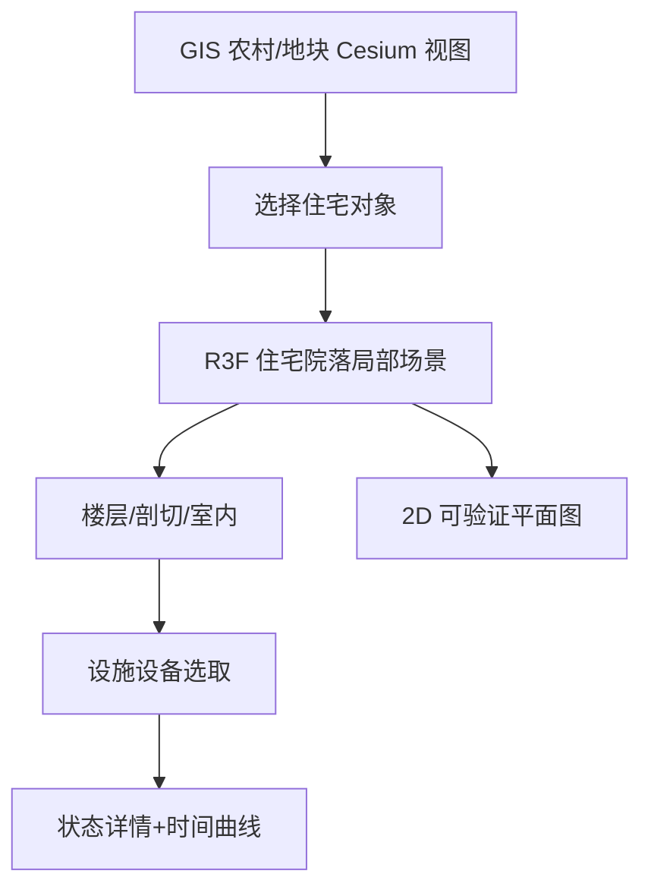

# 03｜空间与数字孪生：农村农田、住宅庭院、工业园区与三维设施

> 领域定位：让**空间事实 + 设备状态 + 时间变化**在同一可理解的 3D 界面中呈现。几何可验证、坐标正确、状态来源可追踪，优先于渲染炫技。遵循 [00 通用规范](./00_通用_单人产品工厂与前端架构规范.md)。

## 1. 场景/尺度决定渲染引擎

| 业务场景 | 空间尺度 | 核心前端能力 | 主渲染器 |
|---|---|---|---|
| **农村、村庄、农田 GIS 孪生** | 百米至公里/区域 | 真地理坐标、卫星影像、地形、农田分区、设备空间点位 | **CesiumJS** |
| **家庭住宅与庭院精细孪生** | 毫米到几十米 | 可核对尺寸、楼层切换、墙门窗、设备、剖切、漫游 | **Three.js + R3F v9** |
| **家庭屋顶光伏/水电设施** | 厘米至几十米 | 构件状态、管线、流向动画、传感器标签 | **R3F + ECharts** |
| **智慧校园 / 园区** | 建筑群/园区 | 地理总览→建筑定位→楼层/房间/设备下钻 | **CesiumJS + 独立 R3F 视图** |
| **工业设备 / 生产线** | 米至百米 | 设备拆装、状态高亮、故障标注、动画 | **R3F / Three.js** |
| **仓储与 AGV** | 大厂房 | 货架 Instancing、导航路径、实时实体位置 | **Three.js + ECharts** |
| **大型城市模型/倾斜摄影** | 公里以上 | 3D Tiles、瓦片流式加载、轨迹和时间 | **CesiumJS** |
| **在线 BIM / CAD 审图** | 构件级 | IFC 构件树、测量、剖切、可见性、批注 | **That Open/IFC.js 生态 + Three.js** |
| **房产户型看房 / 家装配置** | 一套住房 | 换材质、选家具、室内导航、户型对比 | **R3F + Drei** |

**原则：不要强迫 CesiumJS 和 R3F 使用一个 Canvas**。可以统一 React App Shell、设备选择状态和数据契约，但分别挂载 GIS 主视图与高精细局部视图；这也避免双引擎同时占用 GPU 造成性能问题。

## 2. 核心能力分层

| 前端能力层 | 推荐技术 | 实现内容 |
|---|---|---|
| 展示与导航 | React + Next.js 16（综合门户）/ Vite（纯渲染应用） | 工程选择、告警面板、资源树、操作栏 |
| 设计系统 | Tailwind 4 + shadcn/ui + Lucide + Motion | 操作面板、图层控制、可访问弹层 |
| 数据请求 | TanStack Query + Zod | 数据有效性、断连/过期提示、取值单位一致性 |
| 前端状态 | Zustand | 当前园区、楼层、选中设备、图层开关、视角 |
| 地理 3D | CesiumJS、3D Tiles、GeoJSON、CZML | 地形、农田、建筑组、轨迹 |
| 精细 3D | Three.js + R3F + Drei | 房间、家具、管线、设备、拾取/量测 |
| 2D GIS | MapLibre / OpenLayers（必要时） | 操作复杂矢量图层、地图分析编辑 |
| 热力/点群 | deck.gl（明确性能需求时） | 大量空间点/路径的 GPU 表示 |
| 业务图表 | ECharts | 温湿度、水电曲线、异常变化、能耗 |
| 模型资源 | glTF/GLB、3D Tiles、KTX2、Draco/Meshopt | 模型分级下载、纹理内存优化 |
| 渲染优化 | LOD、Instancing、对象合批、Worker、按需渲染 | 大量实体、移动端性能 |

## 3. 农村/农田数字孪生专题

### 3.1 用户旅程

进入真实地理位置 → 选择农田/菜地 → 查看当前环境读数和时间 → 对比趋势 → 定位灌溉区/阀门 → 查看设备最近更新与异常标记 → 返回全局。**前端不得把实时与历史/模拟数据混为一谈。**

### 3.2 建议的显示实体

| 实体 | 必须的数据字段（前端契约） | 图形表现 |
|---|---|---|
| 农田区块 | `fieldId`、几何、多边形坐标、面积单位 | GeoJSON 面填充 + 点击 |
| 传感器 | `deviceId`、定位、类型、状态、采集时间 | Billboard / 标签 / 图标 |
| 灌溉阀门 | 点位、控制权限标识、开闭状态、更新时间 | 设备 glTF + 状态色 |
| 监测点 | 读数、量纲、时间、数据质量 | Popover + ECharts 迷你趋势 |
| 巡检线路 | 路径坐标、时间与来源 | 时间轴/轨迹线 |
| 地形建筑 | 地形高程、瓦片来源、LOD | Cesium Terrain/3D Tiles |

### 3.3 精度与可信度说明

- WGS84 经纬高必须通过明确转换进入局部 ENU（East-North-Up）坐标；不要将经纬度数值直接当成 Three.js `x/z`。
- 影像分辨率不等于地块边界测绘精度。没有实际测量/测绘证明时，不显示虚构的厘米级准确度。
- 区分真实设备、模拟设备和离线设备；颜色不应独自承载告警语义。
- 位置信息、农田面积、边界可来自测量/授权数据，但须说明坐标系、精度和更新日期。

### 3.4 农村数字孪生推荐路线

CesiumJS 的村庄/耕地总览 → 以图层显示设备 → 点击设备建立时间/状态链接 → 有明确价值时增加农田剖面或局部 3D 设备模型。**不要第一阶段就建设整个村庄的写实 3D 建模。**

## 4. 家庭住宅/庭院/设施三维孪生专题

### 4.1 业务与可视化能力

- **空间**：院门、围墙、主屋、厨房、草坪、雨水花园、室内房间、楼梯、阳台、屋顶和车位位置。
- **三维**：楼层显示/隐藏、屋顶切换、相机预设、第一人称/轨道漫游、墙体透明化、剖切、构件拾取。
- **设施**：供水/排水、雨水储存、光伏、电力、照明、空调/温湿度、安全摄像头及安防状态；使用可验证字段，不虚构实时感知。
- **设计比较**：方案 A/B、材质效果、日照和阴影；若未建立精确计算模型，日照只能标注“示意”，不能代替工程验算。
- **无障碍体验**：平面图兜底、键盘操作、楼层构件清单、低运动偏好。

### 4.2 已知住宅项目的“几何输入基线”（需以最新版技术图纸复核）

| 代号/部位 | 已讨论的参考尺度或约束 | 前端验收要点 |
|---|---|---|
| 场地 | **15 m × 14 m = 210 m²** | 俯视外轮廓按真实比例，不可拉伸 |
| H1 主屋 | **11.20 m × 8.40 m** | 轴向、朝向、长宽比、主体位置需与正式图纸一致 |
| K1 重厨房 | **3.60 m × 2.80 m**，位于东南侧 | 只在西侧开门；北侧不开门；与主屋的间距需校核 |
| 楼梯 ST01 | U 形双跑，20 踢面（10+10） | 楼层/扶手/平台和踏步数不能随意示意 |
| 设施 | 雨水花园 RW-01、给排水 WTR 系列、光伏、监控等 | 构件 ID 与场景/数据保持一一对应 |

> **冻结/审图要求**：本表只是理解既有需求的输入，不构成新的施工设计，也不允许用它猜测未给出的定位坐标、标高、门窗尺寸、基础和机电设计。任何建模输出必须与使用者当前批准的 A01/A02/A03 等图纸逐项核验。建造安全与结构规范不属于前端技术栈。

### 4.3 双尺度分离



**坐标约束**：住宅局部使用明确的米制坐标系，如 `x=东、y=上、z=北`，并记录原点、方向、单位。导入 Blender GLB 时处理 `Z-up/Y-up` 差异，给出一个统一的 transform 层，**不要在每个组件里各自旋转**。场地图形与楼层图形只共享已验证的实体 ID、尺寸和局部坐标映射。

### 4.4 “精确模型 vs 视觉示意”分层

| 层级 | 目标 | 来源与验收 |
|---|---|---|
| L0 | 准确边界和体量 | 明确尺寸输入，自动尺寸断言 |
| L1 | 主屋/厨房/围墙/房间 | 图纸与对象 ID 对照 |
| L2 | 楼梯、门窗、雨棚、管井 | 子构件与标高核查 |
| L3 | 家具、花木、灯光、材质 | 美术效果可调整但不得篡改尺寸 |
| L4 | 管线、监控、光伏、给排水流程 | 数据图层与工程标注分开 |

### 4.5 模型内容清单与命名

```text
public/models/
  property/
    site-shell.glb              # 场地外轮廓，唯一几何来源
    house-h1-structure.glb      # 主屋结构
    kitchen-k1.glb              # 厨房结构
    floors/
      first-floor.glb
      second-floor.glb
    facilities/
      solar-roof.glb
      water-system.glb
      security.glb
```

版本清单应包含：`assetId`, `sourceDrawingId`, `drawingRevision`, `units`, `coordinateFrame`, `checksum`, `allowedTolerance`, `lastVerifiedAt`。视觉与图纸有冲突时以经过批准的几何输入为准。

## 5. 统一前端领域模型与事件

```ts
export type SpatialEntity = {
  id: string;
  sceneId: string;
  kind: 'field' | 'building' | 'room' | 'device' | 'pipe' | 'zone';
  label: string;
  geometryRef?: string;
  parentId?: string;
  sourceRevision?: string;
};

export type TelemetrySample = {
  deviceId: string;
  metric: string;
  value: number | null;
  unit: string;
  recordedAt: string; // ISO 时间
  quality: 'observed' | 'simulated' | 'stale' | 'invalid';
};

export type SceneSelection = {
  sceneId: string;
  entityId: string | null;
  view: 'gis' | 'site' | 'interior';
};
```

对不同引擎的拾取操作只发 `SceneSelection`，业务卡片使用实体 ID 查询详情，不直接从 Three.js Mesh 内部读取所有设备属性。显示时把“最近更新时间”和质量状态并列展现。

## 6. 架构、依赖和分包

```text
src/
  app/
    (workspace)/sites/page.tsx
    (workspace)/sites/[id]/page.tsx
  features/
    scene-selector/
    layer-manager/
    device-panel/
    building-explorer/
    telemetry-dashboard/
    spatial-measurements/
  renderers/
    cesium/                       # 只此处允许依赖 CesiumJS
      CesiumSceneClient.tsx
      geo-converters.ts
      cesium-entity-adapter.ts
    house-three/                  # 只此处允许 Three / R3F
      HouseSceneClient.tsx
      components/Wall.tsx
      components/Floor.tsx
      components/Facility.tsx
      coordinate-frame.ts
  contracts/
    entities.ts
    telemetry.ts
    scene-manifest.ts
  assets/
    model-manifest.ts
  design/tokens.css
```

### 6.1 六层懒加载顺序

1. **HTML/UI Shell**：设备列表、地图占位、设备告警摘要先出现。
2. **场景运行时**：用户进入 GIS/住宅模块后加载 Cesium 或 R3F，避免两个引擎首屏同时初始化。
3. **轻量几何**：地块轮廓或低精度建筑先载入，摄像机可操控。
4. **局部模型**：按视角/楼层下载 GLB、3D Tiles 和 KTX2 贴图。
5. **高级效果**：后处理、阴影、分析图层按设备质量开启。
6. **信息图表**：仅在打开设备详情/历史页时动态加载 ECharts 模块。

### 6.2 生命周期清理

- 组件卸载时取消订阅、监听与动画帧；释放几何/材质/纹理引用和已不再使用的 GPU 资源。
- 处理 WebGL Context Lost、Resize、设备像素比变化、标签遮挡和相机异常。
- 场景缓存必须有限额；不要无界累积模型和轨迹历史。
- 网络数据与渲染的刷新频率分离；可用插值/降采样，不允许渲染帧驱动查询。

## 7. 性能与真实度验收

| 主题 | 必须验证 | 失效降级 |
|---|---|---|
| 坐标 | GIS WGS84/高度基准与局部 ENU 映射 | 2D 精确标点、说明误差 |
| 住宅几何 | 场地 15:14、H1/K1 比例、房间/构件 ID | 可核查 SVG 平面图 |
| 选取 | 鼠标/触控拾取显示准确实体 | 构件列表选择 |
| 状态来源 | 实时/历史/模拟/过期可辨 | 显示上次已知值及时间 |
| 性能 | 目标桌面 60 FPS、移动 30 FPS，实测显存/帧时间 | 降低阴影/贴图/模型细节 |
| 离线/断连 | 不伪装为“设备正常实时运行” | 明确离线提示 |
| 资源权限 | 模型、影像与瓦片来源/许可记录 | 无授权内容不公开发布 |
| 视力/运动 | 减少动画、列表代替纯 3D 操作 | 静态图与文字详情 |

## 8. 首个可运行 MVP：农村 + 住宅的两条线

### 8.1 农田 MVP

1. 场地定位、影像/地形授权来源明确。
2. 一个地块 polygon（已核验坐标）+ 3 个模拟设备（醒目标注模拟）。
3. 点击设备出现读数、量纲、更新时间和趋势图。
4. 视图开关与离线提示可测试；换机分辨率不遮住场景核心控件。

### 8.2 住宅 MVP

1. 使用经过确认的尺寸建出场地外轮廓、H1 和 K1 体块。
2. 平面视图与 3D 视图相同对象标识；提供相机正交俯视预设。
3. 增加一层、二层切换和基础可视性操作。
4. 显示一个“水位/光伏/门磁”等可追踪状态点位；可用模拟值但明确标签。
5. 自动几何测试验证场地/主屋/厨房尺寸公差；与图纸并排人工审查。

## 9. OpenCode 执行任务卡

```text
阅读 00 通用规范与 03 数字孪生模板，先检查现有场地/建筑图纸的批准版本。
明确属于 GIS 地理场景还是局部住宅/工厂场景，做单引擎首个切片。
创建唯一坐标系文档：原点、朝向、单位、WGS84/ENU 转换、Blender 轴转换。
使用经过核验的数据建模，严禁按图片目测生成真实尺寸；住宅 H1/K1/场地先有几何断言。
按引擎隔离代码，场景 API 不污染 features 业务代码；3D Runtime 和模型都惰性加载。
前端显示数据质量标签、更新时间和设备断连状态；模拟数据不可冒充实时。
完成功能测试、场景截图、视角测试、桌面/移动帧率和资源清理测试。
仅提交可验证的前端代码/模型引用与验收说明，不改变原始图纸和授权文件。
```

## 10. 官方参考

- CesiumJS：https://cesium.com/learn/cesiumjs-learn/
- Three.js：https://threejs.org/docs/
- React Three Fiber：https://r3f.docs.pmnd.rs/getting-started/introduction
- glTF：https://www.khronos.org/gltf/
- MapLibre：https://maplibre.org/maplibre-gl-js/docs/
- 3D Tiles：https://www.ogc.org/standard/3dtiles/
- [00 通用工程规范](./00_通用_单人产品工厂与前端架构规范.md)