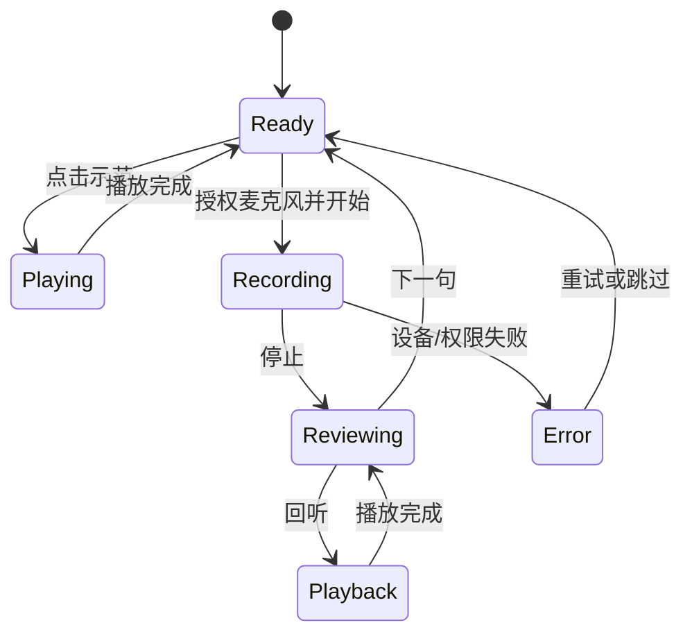

# 04｜教育与专业可视化：语言学习、交互实验、医学与工程教学

> 领域定位：帮助使用者**理解、练习、纠错和验证**，而不是用复杂特效掩盖学习目标或科学数据的不确定性。教育内容需真实、可访问、可复现；专业数据需核对来源。遵循 [00 通用规范](./00_通用_单人产品工厂与前端架构规范.md)。

## 1. 场景与能力矩阵

| 场景 | 首要用户任务 | 推荐前端/渲染 | 非目标/注意 |
|---|---|---|---|
| **英语口语/发音练习** | 听、读、录、回放、复习 | React + Web Audio API + Waveform Canvas + Motion | 无验证模型时不伪造发音评分 |
| **语言学习可视化** | 音标、发声结构、节奏、练习进度 | React + SVG/D3 + Canvas | 不能把波形相似度直接宣称语音准确率 |
| **虚拟物理实验** | 调参、观察结果、比较趋势 | React + R3F/Three.js + ECharts | 未经验证的模拟不能当实验测量 |
| **机械/电路原理教学** | 拆解、旋转、剖切、步骤引导 | R3F + Drei + CSS/Motion | 3D 示意不等于工程审图 |
| **医学影像教学/浏览** | DICOM 切片、窗宽窗位、三维体、标注 | React + Cornerstone3D + vtk.js | 教学展示不等于获准医疗诊断 |
| **化学/生物结构可视化** | 分子旋转、结构选择、状态标注 | Three.js + 领域模型查看器 | 必须保留结构来源及模型版本 |
| **工程培训/维修指导** | 逐步查看部件、交互拆装、正确步骤核对 | Three.js + R3F + XState | 高风险操作仍依赖专业指导 |
| **互动数学课程** | 输入公式、参数操纵、动态图形 | React + KaTeX + SVG / D3 | 数学表达必须可选中/朗读 |

## 2. Voxnelo 型产品的实际基线

真实仓库：https://github.com/kunlong-luo/voxnelo

2026-10 仓库显示：**Electron + React + TypeScript + Rsbuild + Base UI + Tailwind + Lucide**；有听读练习、录音回放、双语界面、学习历史、部分平台的可选离线语音识别支持。**现有软件不应为了前端规范迁移 Next.js**。

### 2.1 建议保留的核心体验

- **一句话练习**：播放系统 TTS → 用户手动录音 → 回放自己的声音 → 收藏/复习。
- **学习材料**：中英文短句、标签、难度、IPA 显示，突出真正的发音重点。
- **学习历史**：明确区分“看过材料”“听过示范”“实际录音练习”；不虚增练习次数。
- **反馈**：只有存在已验证的对齐/识别能力时才给精细纠音结果，其他情况显示转录结果或可重听提示。
- **隐私提示**：录音是否在设备本地、使用了哪种系统语音接口、是否可能请求网络，需要明示。

### 2.2 练习界面状态机



**关键点**：不同状态下只保留允许的主操作按钮；无法获取麦克风权限时仍可听读文字学习，不应强迫授权。

## 3. 专业教育 UI 组件拆分

| 组件 | 能力 | 典型实现 |
|---|---|---|
| Lesson Navigator | 章节、课程、进度、搜索 | React + URL 参数 / 本地状态 |
| Practice Player | 示例播放、变速、音量、回放 | Web Audio API / HTMLAudioElement |
| Recording UI | 麦克风权限、录制计时、错误反馈 | MediaDevices + MediaRecorder（能力检测） |
| Audio Waveform | 音量/时长波形、播放进度 | Canvas/Web Audio analyser |
| IPA/Formula | 音标、数学公式、上下文说明 | 文字/SVG/KaTeX |
| 3D Lab | 试验场景、控件、相机、对象拾取 | R3F + Drei |
| Volume Viewer | 体数据切片/三维体 | Cornerstone3D / vtk.js |
| Guided Steps | 学习任务步骤、分支与复查 | XState 可选 |
| Progress Summary | 实际练习记录、复习计划 | React + ECharts（明确指标） |

## 4. Web Audio 与音频工作负载

### 4.1 音频处理原则

1. 麦克风只在用户主动操作后请求授权；有持续录制的可见提示与停止按钮。
2. 音频时钟与 UI 动画时钟分离；音量波形抽样绘制，无须每一采样触发 React 重渲染。
3. 高频信号处理移到 AudioWorklet / Worker（支持时）；UI 主线程只接收适度降采样统计。
4. 使用系统 TTS 时，必须把声音质量、离线可用性、平台差异标为环境相关。
5. 错误要区分：权限拒绝、无设备、设备占用、格式不兼容、录制过短。
6. 录音、识别结果、历史记录要分别定义保存期限和删除机制；默认不上传敏感音频。

### 4.2 视觉“波形”和科学测量的区别

音量条、实时波形是交互反馈；严格语音评分需要音素对齐、参考数据、模型校准及实测。**切勿把两个音频波形看起来相像就作为“发音得分 95”**。

## 5. 虚拟实验与 3D 教学模板

| 模块 | 交互 | 技术 | 证据要求 |
|---|---|---|---|
| 参数滑杆 | 初始条件、约束范围、单位 | React + Zod + Slider | 显示单位及合法范围 |
| 实时模拟 | 物理/数学状态更新 | Worker/WASM（按需） | 算法版本、公式、误差说明 |
| 3D 操作 | 相机旋转、模型剖切、步骤显示 | R3F + Drei | 以 glTF/GLB 表示模型，保持几何比例 |
| 实验结果 | 曲线、对比、导出示意 | ECharts / D3 | 数据来源标识“模拟/测量” |
| 教学指导 | 逐步提示、错误回滚 | Motion + 状态机 | 没通过也能复习步骤 |
| 降级 | 静态原理图+表格 | SVG/HTML | WebGL 不支持仍可阅读 |

**实验最小闭环**：加载一个模型 → 改变一个参数 → 观察真实定义的变化 → 回到默认 → 解释结果。不必先做完整课程平台。

## 6. 医学影像与高风险专业可视化

- **Cornerstone3D** 适合 DICOM 影像查看、切片/交互；**vtk.js** 适合体数据与专业 3D 科学渲染。选型需核对可支持的 DICOM 传输/格式和部署条件。
- 用于教学的数据要脱敏或为合规公开示例；影像文件和截图可能含隐私信息。
- 显示 Orientation、Spacing、Window/Level 等量应以数据元为准；禁止因 UI 缩放而改变标尺含义。
- 鼠标操作和批注要有事件记录；渲染错误或图像缺片要清楚提示，不显示一个“看似完整”的体模型。
- 任何“诊断/临床使用”的产品都需要另行验证适用法规、设备属性与专业准确性；本卷不提供医学结论。

## 7. 前端架构与分包

```text
src/
  app/                             # 框架入口
  features/
    course-catalog/
    lessons/
    practice-session/
      PracticeView.tsx
      state/practice-machine.ts
    speech/
      audio-permissions.ts
      recorder-client.ts
      waveform-client.ts
    experiment/
      ExperimentShell.tsx
      ExperimentCanvasClient.tsx   # 3D 懒加载
      simulation-contract.ts
    medical-viewer/
      DicomViewerClient.tsx       # 独立重型 chunk
    progress/
  contracts/
    lesson.ts
    practice-event.ts
    experiment-result.ts
  components/ui/
  design/tokens.css
```

### 分包策略

| 资源 | 触发时机 | 优化方法 |
|---|---|---|
| Course & Lesson 文本 | 首屏 | HTML/轻量 JSON、局部搜索 |
| Audio Recorder / Worklet | 进入练习+用户同意 | 仅在录制功能启用时加载 |
| 3D 模型与 Three.js | 打开实验 | Canvas 懒加载 + Poster + GLB 分级 |
| Cornerstone/vtk.js | 打开医学工具 | 完全独立路由与运行包 |
| ECharts | 查看学习报告 | 轻图优先，复杂图按需 |
| 高质量音频素材 | 用户播放或预取下一句 | 按语言/课程分片，离线策略明确 |

要把音频 Worklet、医学影像 Worker 和 3D 资源都正确地接入当前构建器，不假设 Next/Vite/Rsbuild 的 worker URL 配置相同。

## 8. UI 质量与可访问性

- 字幕、语言替代与转录显示；按文本与音频配对，而不是只有声音反馈。
- 音频录制具可见状态和倒计时/实时计时；禁止意外自动录音。
- 支持触控大按钮、键盘快捷键、字体缩放、国际化、减少动态效果。
- 3D 场景提供构件树与文字步骤，避免色弱用户只靠颜色理解。
- 视频课程提供字幕/文字版和正常速度播放；复杂动画不能强制播放。
- 展示操作、学习次数和实际完成记录，不用虚构“学习效果提高 80%”。

## 9. 场景 MVP 与验收

| MVP | 完成范围 | 一条验收路径 |
|---|---|---|
| 语言学习 | 10–20 个有授权短句、播放录音复习 | 播放→录制→回放→复习→刷新状态正确 |
| 互动实验 | 一个对象、一个参数、一条解释曲线 | 调参→场景和图表同步→重置 |
| 机械拆装 | 一台经过授权的设备模型、3 个部件 | 选中→隐藏/分解→查看步骤→复位 |
| 医学教学 | 一组合法样例影像、基础浏览操作 | 打开→切片→缩放→重置→退出释放内存 |

### 质量门禁

- [ ] 数据/内容来源、单位和教学解释可追查。
- [ ] 所有浏览器权限由用户操作触发，可撤销/停止。
- [ ] 不声称未验证的语音/科学/医学准确性。
- [ ] 设备断开、麦克风拒绝、模型失败有明确后路。
- [ ] 图形内容有可读的文字备选；低性能设备可完成教学主线。
- [ ] 录音和影像保存/上传策略被明确展示。

## 10. OpenCode 领域任务卡

```text
阅读 00 通用规范与 04 教育专业模板，检查现有代码（Voxnelo 项目不能未经批准更换 Rsbuild/Electron）。
识别产品是语言练习、互动实验、工程培训还是影像浏览，先实现一个可完整演示的学习任务。
前端状态区分用户操作、设备权限、模拟结果和真实观测；数据集必须可追溯。
音频和 3D/影像高负载能力分别独立 Chunk/Worker，避免阻塞普通课程目录。
提供录音失败、模型失败、无 WebGL 和减少动画的替代路径。
补全可访问性、桌面/手机、类型、Lint、Unit/E2E 验收并记录真实运行结果。
不得编造识别准确率/医疗诊断/课程效果或擅自收集音频与影像。
```

## 11. 官方参考

- Voxnelo：https://github.com/kunlong-luo/voxnelo
- Web Audio：https://developer.mozilla.org/en-US/docs/Web/API/Web_Audio_API
- MediaRecorder：https://developer.mozilla.org/en-US/docs/Web/API/MediaRecorder
- Cornerstone：https://www.cornerstonejs.org/
- vtk.js：https://kitware.github.io/vtk-js/
- React Three Fiber：https://r3f.docs.pmnd.rs/getting-started/introduction
- [00 通用工程规范](./00_通用_单人产品工厂与前端架构规范.md)