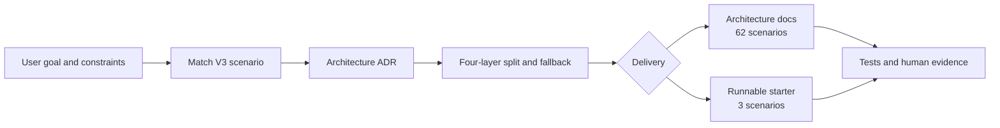

<div align="center">

# Archvela

### From ideas to verifiable frontend architecture

A **scenario-first frontend architecture Skill and toolkit** for independent developers and AI coding assistants. Understand the product constraints first, make architecture tradeoffs, then produce auditable plans or a runnable starter.

[简体中文 / Chinese](./README.zh.md) · [Getting Started](./docs/GETTING-STARTED.md) · [Scenario Catalog](./.agents/skills/archvela-architect/references/07_V3_全场景蓝图与选型索引.md) · [Contributing](./CONTRIBUTING.md)

[](https://github.com/kunlong-luo/archvela/actions/workflows/validate.yml)
[](https://github.com/kunlong-luo/archvela/actions/workflows/compatibility.yml)
[](https://github.com/kunlong-luo/archvela/actions/workflows/examples.yml)
[](https://github.com/kunlong-luo/archvela/actions/workflows/security.yml)
[](./LICENSE)

**62 architecture scenarios · 6 domains · 3 runnable starters · 20 installer targets**

</div>

> [!IMPORTANT]
> **Pre-release software.** The 62 scenarios are architecture references, **not** 62 complete applications. Only V3-02, V3-14, and V3-26 currently generate runnable source projects. CI validates metadata and installer behavior (L0/L1); real-agent discovery and improved coding outcomes (L2/L3) have **not** been demonstrated. No official GitHub Release exists.

## English-first Skill discovery; Chinese source catalog

The installed [Skill entrypoint](./.agents/skills/archvela-architect/SKILL.md) now uses English-first discovery metadata and decision rules, backed by a [six-domain English architecture guide](./.agents/skills/archvela-architect/references/ENGLISH-DECISION-GUIDE.md). It evaluates existing React, Vue, Astro, Next.js and other stacks **by project constraints**, not framework preference. The detailed 62-scenario V3 catalog remains primarily in Chinese; the guide is **not** a complete translation. Installation checks do not establish native L2 discovery or model-quality improvement.

## What problem does Archvela solve?

AI assistants can write code quickly but still overengineer a simple website, select an unsuitable framework, blur module boundaries, or present unverified performance claims. Archvela gives an auditable path from product intent to acceptance criteria:



- **Scenario-first decisions.** Identify the core user journey, SEO, accessibility, target devices and resource budgets before selecting Next.js, Vite, Astro, React or rendering tools.
- **Respect existing systems.** Audit before refactoring; switching frameworks needs evidence, not fashion.
- **Four explicit boundaries.** Separate reusable packages, user-facing features, JavaScript chunks and media/3D asset packs.
- **Safe by default.** Generators preview before writing and reject collisions. Draft architecture is not verified implementation.

## Install in one command

From **your target project directory**, with Node.js 22.20+, npm and access to GitHub:

```bash
npx skills add kunlong-luo/archvela --skill archvela-architect
```

Choose an agent interactively, or install to several supported clients in one project:

```bash
npx skills add kunlong-luo/archvela --skill archvela-architect \
  --agent codex --agent claude-code --agent opencode --copy --yes
```

Add `--global` for user-wide rather than project-local installation. The `--copy` option avoids a dependency on symlinks to the source repository. For Cursor, Gemini CLI, Copilot, Windsurf and more, see the [20-target compatibility matrix](./docs/COMPATIBILITY.md).

**What is verified:** CI checks 20 local Skills CLI installation targets and exercises public GitHub-source installation for Codex, Claude Code and OpenCode, as well as pinned-commit installation. That is **L1 installer verification**, not proof that their live models discovered, invoked or benefited from the Skill. Review any third-party scripts before installing.

**Example prompt to use inside your agent:**

> Use `archvela-architect` to plan a premium marketing website with SEO and poor-network fallbacks. Ask about essential constraints first. Return a scenario ID, ADR, four-layer split, performance budget, and acceptance criteria for three small PRs. **Analyze only; do not change files.**

For offline scenario search, clone the repository and use its Python scripts:

```bash
git clone https://github.com/kunlong-luo/archvela.git
cd archvela
python3 .agents/skills/archvela-architect/scripts/scenes.py --query "home digital twin"
```

[Full walkthrough, troubleshooting and both usage paths →](./docs/GETTING-STARTED.md)

## What ships today?

| Capability | Status | Output |
|---|---|---|
| 62 scenarios across six domains | Available | Decision guidance, key tasks, risks and acceptance ideas |
| Portable Agent Skill | L1 verified | `SKILL.md`, progressive references, optional Python tools |
| Architecture document generator | Available | ADR, performance / split budget, agent delivery card; optional `archvela-plan.json` |
| Project scaffolding | **3 starters** | Separate Next/Vite projects, lockfiles and architecture drafts |
| Browser acceptance | Automated | Chromium desktop/mobile **viewports**, not physical GPU certification |
| Live agent-effectiveness benchmark | **Not run** | 12-task paired harness and an operator-only pilot preparation tool |

### Six domains

| Domain | Scenarios | Examples |
|---|---:|---|
| Commercial websites and showcases | 13 | Marketing sites, storefronts, configurators |
| Business apps and productivity | 11 | SaaS, AI workspaces, BI, editors |
| Spatial and digital twins | 12 | Homes, agriculture, factories, BIM |
| Education and expert visualization | 8 | Language learning, simulations, training |
| Games and immersive media | 9 | Web games, exhibitions, XR |
| Geospatial and public data | 9 | GIS, thematic maps, animated trajectories |

Browse the [V3 catalog](./.agents/skills/archvela-architect/references/07_V3_全场景蓝图与选型索引.md), IDs `V3-01` to `V3-62`.

## Three runnable starters

| Scenario | Stack | User interaction |
|---|---|---|
| [V3-02 · Cinematic Site](./examples/cinematic-site) | Next.js 16 / React 19 / lazy Three.js | SEO-friendly marketing site with opt-in interactive 3D |
| [V3-14 · SaaS Workspace](./examples/saas-workspace) | Next.js 16 / React 19 | Search, filtering, state changes and on-demand chart |
| [V3-26 · Home Digital Twin](./examples/home-digital-twin) | Vite 8 / React 19 / R3F 9 | 2D-first house concept with optional 3D and fallback |

These are **isolated demonstrations with fictional data**, not production applications or engineering-grade construction models. See [runnable examples](./examples/README.md).

Generate a separate project from a tested scenario (preview before writing):

```bash
python3 scripts/archvela_create.py list
python3 scripts/archvela_create.py create --scene V3-26 --project home-demo --output ./workspace
python3 scripts/archvela_create.py create --scene V3-26 --project home-demo --output ./workspace --write
cd workspace/home-demo
npm ci && npm run build
```

The other **59 scenarios generate architecture documentation only**, not runnable application source. [Generator design and safety →](./docs/PROJECT-GENERATOR.md)

## Architecture discipline

| Layer | Question |
|---|---|
| **Package** | What is truly shared across projects? Would independent repositories be simpler? |
| **Feature** | How does each module align to an actual user task? |
| **JS Chunk** | What should load lazily, such as maps, editors, or 3D? |
| **Asset Pack** | How should GLB, video, texture, images and map tiles load and degrade? |

The optional `archvela-plan.json` lets one Agent hand off decisions to another; `plan_contract.py` checks the **structure** of `draft`, `reviewed` or `delivered` evidence, not the truth of claims. [Planning contract →](./docs/PLAN-CONTRACT.md)

### What our validation actually means

- **L0:** Skill metadata, scripts, catalog invariants and regression tests.
- **L1:** 20 Skills CLI local installation targets; six global-target checks; Codex / Claude Code / OpenCode public GitHub installation and pinned-commit installation.
- **L2/L3:** Real client discovery, model calls, and paired architecture/coding outcomes remain **unverified**. The [offline pilot summary tool](./benchmarks/summarize_pilot.py) can reconcile 12 operator-supplied sessions and human grades without dropping failed attempts or pooling different models; **no real sessions have been run**. [Evaluation protocol](./docs/AGENT-EVAL-PROTOCOL.md) · [Tracking issue #21](https://github.com/kunlong-luo/archvela/issues/21).
- **CI:** Lockfiles, independent example builds, generated-project builds, Chromium E2E, CodeQL, four npm audits and PR dependency review. Passing CI cannot guarantee security or physical-device compatibility.
- **Evidence & provenance:** [Operator-run pilot audit](./docs/REAL-AGENT-PILOT.md) checks real-session evidence *files* and hashes without model calls; [media provenance register](./docs/ASSET-PROVENANCE.md) blocks unrecorded standalone assets. Neither proves model benefit nor clears all third-party copyrights.

## Repository map

```text
.agents/skills/archvela-architect/  # Skill, references, scenarios and helper scripts
scripts/                          # Independent starter generator and installer checks
examples/                         # Three isolated runnable starters
tests/                            # Python regression and Playwright browser tests
benchmarks/                       # Offline paired study and unexecuted pilot cards
compatibility/                    # 20 agent installation targets
docs/                             # Getting started, architecture and release gates
.github/workflows/                # Seven CI workflows
```

## Development and community

Auxiliary tools require **Python 3.10+**; the frontend examples and CI use **Node.js 24**.

```bash
python3 -m unittest discover -s tests -v
python3 -m compileall -q .agents/skills/archvela-architect/scripts
```

Read [CONTRIBUTING.md](./CONTRIBUTING.md) before opening a PR. Report vulnerabilities through [SECURITY.md](./SECURITY.md), never by disclosing secrets or exploit details in a public issue. [Open an issue](https://github.com/kunlong-luo/archvela/issues) for bugs, scenario proposals or discussion.

## License and release status

Archvela is **pre-release**. No tag, Release, production deployment or model benchmark should be claimed without evidence. See [Release Readiness](./docs/RELEASE-READINESS.md). The [MIT License](./LICENSE) covers only original material the owner is authorized to license; third-party assets, datasets, trademarks and sourced text require separate permission and provenance review.

---

<div align="center">
  <sub>For independent makers who choose evidence, clarity and maintainability over framework hype.</sub>
</div>
