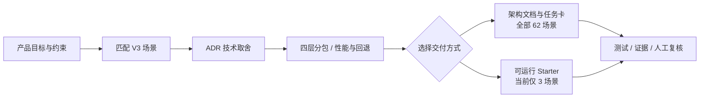

<div align="center">

# Archvela

### 从产品想法，到可验证的前端架构
**From Ideas to Architecture**

面向独立开发者与 AI Coding Agent 的场景驱动架构 Skill。先理解产品与约束，再选择技术、规划分包、生成架构草案或可运行的项目起点。

[English](./README.md) · [快速上手](./docs/GETTING-STARTED.zh.md) · [场景目录](./.agents/skills/archvela-architect/references/07_V3_全场景蓝图与选型索引.md) · [参与贡献](./CONTRIBUTING.md)

[](https://github.com/kunlong-luo/archvela/actions/workflows/validate.yml)
[](https://github.com/kunlong-luo/archvela/actions/workflows/compatibility.yml)
[](https://github.com/kunlong-luo/archvela/actions/workflows/examples.yml)
[](https://github.com/kunlong-luo/archvela/actions/workflows/security.yml)
[](./LICENSE)

**62 个场景参考 · 6 大领域 · 3 个可运行 Starter · 20 个 Agent 安装目标**

</div>

> [!IMPORTANT]
> **项目仍处于预发布阶段。** 62 个场景是架构参考，不是 62 套完整应用；当前仅 V3-02、V3-14、V3-26 能生成可运行代码。安装与 CI 验证属于 L0/L1；真实模型是否能正确调用 Skill、是否改善交付质量仍待 L2/L3 实测。尚未创建正式 GitHub Release。

## 为什么需要 Archvela？

AI 能快速生成页面，但仍可能选错架构、把轻量站点做成复杂应用、混淆分包层级，或者输出无法验证的“最佳方案”。Archvela 将规划过程约束为一条可以审查的链路：



- **场景先行**：先确定用户旅程、SEO、设备、离线、可访问性和风险，再选择 React / Next.js / Vite / Astro 等候选方案。
- **不强迫重构**：已有项目优先只读审计；新技术要有可证明的收益和迁移成本。
- **四层分包**：分别规划 Package、Feature、JS Chunk、Asset Pack，避免把代码组织与资源加载混为一谈。
- **安全且可追溯**：生成器默认预演，不覆盖已有文件；架构结论与真实测试结果严格区分。

## 30 秒安装

在**你的目标项目目录**运行（需要 Node.js 22.20+、npm 与 GitHub 网络访问）：

```bash
npx skills add kunlong-luo/archvela --skill archvela-architect
```

按交互提示选择 Agent；或者直接在同一项目安装到三个常用客户端：

```bash
npx skills add kunlong-luo/archvela --skill archvela-architect \
  --agent codex --agent claude-code --agent opencode --copy --yes
```

需要用户级安装而非项目级安装时加 `--global`。Cursor、Gemini CLI、GitHub Copilot、Windsurf 等目标请查看 [20 个目标及路径说明](./docs/COMPATIBILITY.md)。`--copy` 采用实际文件副本，避免对源仓库符号链接的依赖。

> 这条 GitHub 来源安装命令已在 CI 对 Codex、Claude Code、OpenCode 进行了**安装器与文件落盘验证**；它不等于已在三种客户端里完成真实模型推理。对第三方安装脚本与仓库内容请先审核。

**安装之后，在 Agent 中试试：**

> 使用 `archvela-architect`，为一个支持 SEO 和弱网降级的高端企业官网规划技术架构。先询问必要约束，输出场景 ID、ADR、四层分包、性能预算和 3 个小 PR 的验收计划。**仅分析，不修改代码。**

无需 Agent 也能运行场景检索（在克隆后的 Archvela 仓库根目录）：

```bash
git clone https://github.com/kunlong-luo/archvela.git
cd archvela
python3 .agents/skills/archvela-architect/scripts/scenes.py --query "home digital twin"
```

[详细安装、常见错误与两条完整体验路线 →](./docs/GETTING-STARTED.zh.md)

## 你能获得什么？

| 能力 | 当前状态 | 交付内容 |
|---|---|---|
| 六大领域 / 62 场景 | 可用 | 架构选型、核心任务、风险与验收思路 |
| Agent Skill | L1 已验证 | `SKILL.md` + 渐进式参考资料 + Python 辅助工具 |
| 架构文档生成 | 可用 | ADR、性能与分包预算、Agent 任务卡；可选 `archvela-plan.json` |
| 项目代码生成 | **3 个 Starter** | 独立 React/Next/Vite 工程、锁文件与架构草案 |
| 浏览器测试 | CI 已运行 | 桌面与移动视口 Chromium E2E，非真实手机 GPU 认证 |
| 真实 Agent 效果评测 | **未完成** | 已提供 12 任务配对评测框架和真实试点准备工具 |

### 六大领域

| 领域 | 场景数 | 典型方向 |
|---|---:|---|
| 网站与商业展示 | 13 | 企业官网、独立站、产品展示、3D 配置器 |
| 业务应用与生产工具 | 11 | SaaS、AI 工作台、BI、编辑器 |
| 空间与数字孪生 | 12 | 住宅、农业、工业设施、BIM |
| 教育与专业可视化 | 8 | 语言学习、交互实验、专业训练 |
| 互动娱乐与沉浸体验 | 9 | Web 游戏、虚拟展馆、XR |
| 地理数据与公共展示 | 9 | GIS、专题地图、轨迹与数据叙事 |

完整数据见 [V3 场景目录](./.agents/skills/archvela-architect/references/07_V3_全场景蓝图与选型索引.md)，按编号 `V3-01` 到 `V3-62` 检索。

## 三个可以运行的示例

| 场景 | 技术方案 | 实际演示 |
|---|---|---|
| [V3-02 · Cinematic Site](./examples/cinematic-site) | Next.js 16 / React 19 / 按需 Three.js | SEO 优先的企业官网、点击后加载与卸载 3D |
| [V3-14 · SaaS Workspace](./examples/saas-workspace) | Next.js 16 / React 19 | 搜索、筛选、状态操作、按需图表 |
| [V3-26 · Home Digital Twin](./examples/home-digital-twin) | Vite 8 / React 19 / R3F 9 | 先显示 2D 平面图，再加载 3D，具备 WebGL 降级 |

这些是**独立工程与虚构演示数据**，不是商业成品、真实 IoT 接入或具施工精度的住宅模型。详见 [示例与运行方法](./examples/README.md)。

从场景生成一个新项目（默认 **dry-run**，最后一步才写入）：

```bash
python3 scripts/archvela_create.py list
python3 scripts/archvela_create.py create --scene V3-26 --project home-demo --output ./workspace
python3 scripts/archvela_create.py create --scene V3-26 --project home-demo --output ./workspace --write
cd workspace/home-demo
npm ci && npm run build
```

其余 **59 个场景仅支持生成架构文档**，不会假装能输出完整可运行的项目。[生成器完整说明 →](./docs/PROJECT-GENERATOR.md)

## 设计与质量约束

| 边界 | 需要回答的问题 |
|---|---|
| **Package** | 是否真的需要跨项目复用？独立仓库是否更简单？ |
| **Feature** | 用户实际完成什么任务？功能模块按什么边界划分？ |
| **JS Chunk** | 哪些路由、地图、编辑器或 3D 功能必须按需加载？ |
| **Asset Pack** | 图片、GLB、视频、纹理和瓦片如何分级、压缩与回退？ |

`archvela-plan.json` 可以把这些决策从一个 Agent 交给另一个 Agent；`plan_contract.py` 提供 `draft`、`reviewed`、`delivered` **字段/证据结构**检查，但不声称其能验证事实真实性。[结构化计划合同 →](./docs/PLAN-CONTRACT.md)

### 验证范围，而非宣传数字

- **L0**：Skill 元数据、62 场景和工具脚本测试。
- **L1**：Skills CLI 本地来源 20 目标安装检查、六个全局目标测试，以及 Codex / Claude Code / OpenCode 的 GitHub 来源安装和固定提交安装测试。
- **L2/L3**：实际客户端发现、模型调用、架构/代码质量对照——**尚未取得真实试验结果**。[评测协议](./docs/AGENT-EVAL-PROTOCOL.md) · [试点跟踪 #21](https://github.com/kunlong-luo/archvela/issues/21)
- **CI**：锁文件、示例/生成项目构建、Chromium E2E、CodeQL、四组 npm 审计与 PR Dependency Review。通过检查不保证零漏洞，也不代表所有设备通过。

## 仓库导航

```text
.agents/skills/archvela-architect/  # Skill、六大领域参考、62 场景、工具
scripts/                          # 独立项目生成器、兼容验证
examples/                         # 三个可运行的独立 Starter
tests/                            # Python 回归与 Playwright E2E
benchmarks/                       # 配对评测、真实客户端试点准备（未运行模型）
compatibility/                    # 20 个 Agent 的安装目标清单
docs/                             # 入门、兼容性、架构合同、发布门禁
.github/workflows/                # 七条 CI 工作流
```

## 开发、贡献与安全

要求 **Python 3.10+**（辅助工具）和 **Node.js 24**（示例工程与 CI）。在仓库根目录运行：

```bash
python3 -m unittest discover -s tests -v
python3 -m compileall -q .agents/skills/archvela-architect/scripts
```

提交代码前请阅读 [CONTRIBUTING.md](./CONTRIBUTING.md)；提交安全漏洞请遵循 [SECURITY.md](./SECURITY.md)，不要在公开 Issue 贴出密钥或利用细节。可通过 [Issues](https://github.com/kunlong-luo/archvela/issues) 提出场景、缺陷或改进建议；大型变更先讨论设计取舍。

## 项目状态与许可

Archvela 仍为**预发布项目**，版本标签、Release、部署及正式模型评测都不应凭空宣称完成。[Release Readiness](./docs/RELEASE-READINESS.md) 记录明确的发布门禁。项目以 [MIT License](./LICENSE) 授权权利人有权许可的原创代码和文档；第三方素材、商标、数据集与引用内容仍需独立检查许可证与来源。

---

<div align="center">
  <sub>Built for independent makers who prefer evidence, clarity and maintainable software over framework hype.</sub>
</div>
